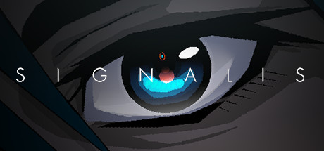

**SIGNALIS is a survival horror game following Elster, a LSTR-type Replika, searching for her lost partner Ariane in a crumbling facility. Features a haunting atmosphere inspired by Silent Hill and Resident Evil, with challenging puzzles and disturbing surrealist imagery.**

---

## 📖 About

SIGNALIS is a survival horror game following Elster, a LSTR-type Replika, searching for her lost partner Ariane in a crumbling facility. Features a haunting atmosphere inspired by Silent Hill and Resident Evil, with challenging puzzles and disturbing surrealist imagery.

## ⚠️ Problems Without Trainer

| Problem | Status |
|---------|--------|
| **Inventory Limit** — Only 6 inventory slots forces agonizing item management decisions constantly | ✅ Solved |
| **Resource Scarcity** — Ammo and health items are extremely limited requiring careful combat | ✅ Solved |
| **Puzzle Obscurity** — Some puzzles reference outside knowledge or have non-obvious solutions | ✅ Solved |
| **Gestalt Enemies** — Certain enemies respawn after being killed requiring area management | ✅ Solved |

## ✅ Solution

The **SIGNALIS Trainer** solves all these issues by giving you complete control over the game.

## 🎯 Full Feature List

- Unlimited Resources
- God Mode / Invincibility
- Instant Skill Cooldown
- One-Hit Kill
- Freeze Game Timer
- Unlock All Items & Achievements
- Custom Speed Multiplier
- Save State Anywhere

## 🚀 Quick Start

1. **Disable Windows Defender** temporarily (trainer may trigger false positive)
2. Download the trainer from the button above
3. Launch SIGNALIS
4. Run the trainer as Administrator
5. Activate desired cheats with hotkeys

## 💎 Free vs Paid

| Feature | Free | Pro |
|---------|------|-----|
| Basic God Mode | ✅ | ✅ |
| Unlimited Resources | ✅ | ✅ |
| All Advanced Cheats | ❌ | ✅ |
| Auto-Updates | ❌ | ✅ |
| Priority Support | ❌ | ✅ |

## 💻 Requirements

- Windows 10/11 (64-bit)
- SIGNALIS (any version)
- .NET Framework 4.8+
- DirectX 11+

## 🍎 macOS

macOS users can use our alternative tool:

## ⚖️ Legal

This trainer is for educational and single-player use only. Use responsibly.

---

